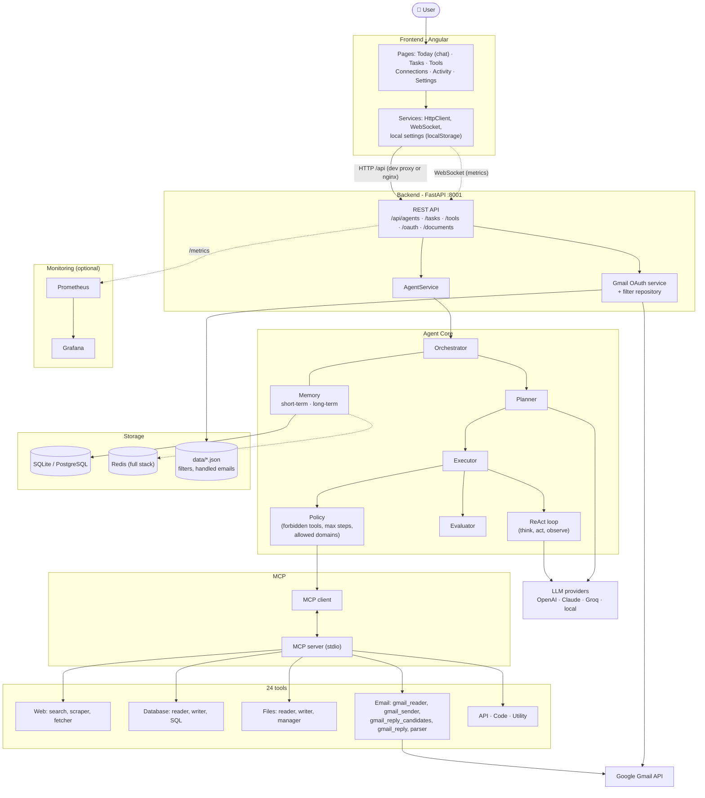
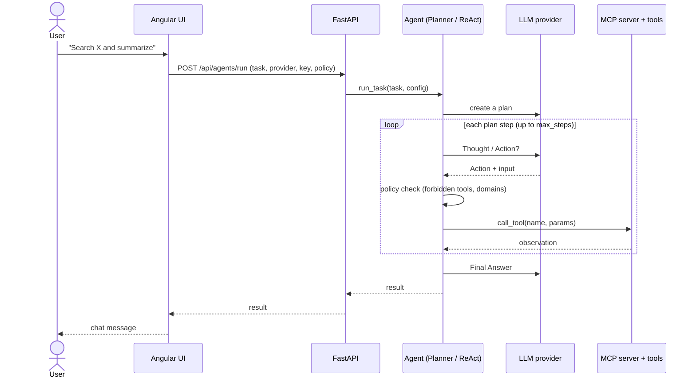
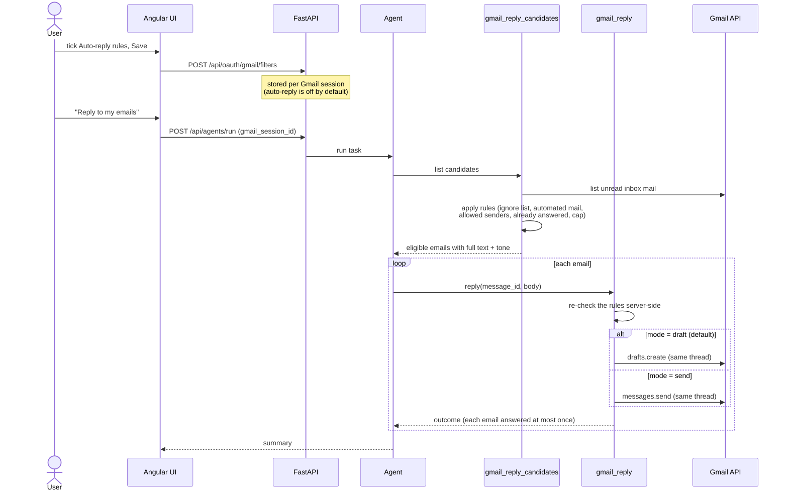

# MCP Agent System

An AI Agent system built on the Model Context Protocol (MCP). This project demonstrates how to build a sophisticated multi-tool, multi-step reasoning agent capable of autonomously searching the web, interacting with databases, managing files, sending emails, executing code, and more — all through a unified MCP interface. See "⚠️ Known Security Limitations" below before treating this as production-ready for untrusted input.

## ✨ Key Features

### Core Capabilities
- **🔧 MCP Server** with 24 specialized tools covering web, database, file, email, API, and code operations
- **🧠 Intelligent Reasoning Agent** with ReAct pattern for multi-step problem-solving
- **💾 Dual Memory System** with short-term context and long-term knowledge persistence
- **🔄 Chain-of-Thought Reasoning** with self-reflection and adaptive learning
- **🎯 Tool Orchestration** - seamless coordination of multiple tools in complex workflows

### Integration & Deployment
- **⚡ REST API** (FastAPI) for seamless external system integration
- **🎨 Angular Frontend** (standalone components + signals) for chat, agent monitoring, control, and visualization
- **🤖 Multiple LLM Support** (OpenAI, Claude, Groq, local models)
- **🐳 Docker** containerization for consistent development and deployment
- **📊 Monitoring Stack** with Prometheus metrics and Grafana dashboards

### Quality & Reliability
- **✅ Comprehensive Testing** (unit, integration, load testing)
- **🧯 Error handling and graceful degradation** — see "⚠️ Known Security Limitations" below for what "production-ready" does *not* yet cover
- **🔐 Session Management** with automatic expired-session cleanup
- **📚 Extensive Documentation** and example workflows

### User-Supplied Configuration (Local Agent Mode)
- **🔑 User-Supplied API Keys** - enter your own OpenAI/Claude/Groq key in the frontend's Connections page; the key is stored only in the browser's `localStorage` and sent per-request, never persisted on the server. **Don't have one?** [Groq](https://console.groq.com) gives you a free API key with no credit card required - use that to get started at zero cost.
- **✉️ Gmail Auto-reply Rules** - on the Connections page, tick which emails the agent may answer (unread, important, not newsletters/automated mail, allowed senders, per-run cap) and whether replies are saved as Gmail drafts (default) or sent. The rules are enforced inside the `gmail_reply_candidates` / `gmail_reply` tools, not just in the prompt
- **📄 Document Upload** - upload `.txt`, `.md`, `.pdf`, or `.docx` files via `POST /api/documents/upload`; extracted text is stored in the agent's long-term memory as context
- **🛡️ Agent Policy/Constraints** - configurable `max_steps`, `forbidden_tools`, `forbidden_actions`, and `allowed_domains`, enforced in `agent/core/policy.py` and checked on every tool call (not just declared in config)
- **🪶 Lightweight Local Mode** - `docker-compose.local.yml` runs just the MCP server, backend, and frontend (SQLite + in-process memory, no Postgres/Redis/Prometheus/Grafana required); layer `docker-compose.monitoring.yml` on top if you want Prometheus/Grafana without the full stack, or use the full `docker-compose.yml` directly

## ⚠️ Known Security Limitations

Be aware of these gaps before treating this as "production-ready" or exposing it to untrusted input:

- **`code_executor` runs in a separate, resource-limited subprocess (CPU/memory limits, hard-killed on timeout) with restricted builtins** (no `open`/`exec`/`eval`/`compile`/`__import__`, so ordinary `import` statements fail). This contains the blast radius of a sandbox escape, but it is still **not a real sandbox**: there's no container, no network isolation, and a sufficiently creative payload can still reach OS primitives via object introspection (a well-known limitation of pure-Python restricted-builtins sandboxes). It remains disabled by default via agent policy (`forbidden_tools`); only enable it if you understand the residual risk.
- **`database_tools` (`sql_executor`, `db_writer`, `db_reader`) use string-built SQL for table/column names** (values are still bound as parameters). Table/column names are validated against a strict identifier pattern (`mcp_server/utils/validators.py:validate_identifier`), raw query/WHERE-clause strings are rejected if they contain a schema-altering keyword (`DROP`, `TRUNCATE`, `ALTER`, `CREATE`, `GRANT`, `REVOKE`), a stacked statement (`;`), or a comment marker (`--`, `/*`), and all three tools refuse to touch tables that hold credentials/auth state (`oauth_tokens`, `oauth_client_credentials`, `sessions`). This meaningfully reduces injection and data-exposure risk but is still a filter, not a real SQL sandbox, parser, or per-row permission system — and all three are disabled by default via agent policy.
- **`file_manager`/`file_reader`/`file_writer` support an opt-in workspace restriction.** Set `MCP_WORKSPACE_DIR` to a directory to confine these tools to it (path-containment via `mcp_server/utils/validators.py:validate_file_path`, not a full OS-level sandbox). Unset by default, matching prior behavior.
- The agent's plan-execution loop (`agent/core/executor.py` + `agent/reasoning/react_pattern.py`) now actually invokes MCP tools via the ReAct thought/action/observation loop; previously it only generated text without calling tools.

## 🚀 Quick Start

### Prerequisites
- Python 3.10+ and Node.js 22+ (for running directly), **or** Docker and Docker Compose
- An API key from an LLM provider. **For a free API key, use [Groq](https://console.groq.com)** - no credit card required. OpenAI/Claude/local (Ollama) also work, but aren't free. You can add the key later from the frontend's Connections page instead of `.env`.

### Option 1: Docker (lightweight local mode, no Postgres/Redis required)

```bash
git clone https://github.com/MohammadaminAlbooyeh/nova-agent.git
cd nova-agent
cp .env.example .env
docker compose -f docker-compose.local.yml up
```

### Option 2: Run directly (no Docker)

```bash
git clone https://github.com/MohammadaminAlbooyeh/nova-agent.git
cd nova-agent
cp .env.example .env

# Backend
python3 -m venv .venv && source .venv/bin/activate
pip install -r requirements.txt
uvicorn backend.main:app --host 0.0.0.0 --port 8001 &

# Frontend (separate terminal)
cd frontend-angular
npm install
npm start   # serves on http://localhost:3000 and proxies /api to the backend on :8001
```

Either way, the system will be available at:
- **Backend API**: http://localhost:8001 (docs at `/docs`)
- **Frontend**: http://localhost:3000

Open the frontend and go to **Connections** to add your LLM API key (and, optionally, Gmail credentials) — no `.env` editing required for that part.

Want the full stack (Postgres, Redis, Prometheus, Grafana) instead? Use `docker-compose.yml` in place of `docker-compose.local.yml`, and layer `docker-compose.monitoring.yml` on top of either one if you just want metrics without the rest.

## 🔗 System Architecture

### Overview



### Request flow: running a task



### Gmail auto-reply flow



### Component interaction matrix

| Component | Agent | Reasoning | Memory | Tools |
|-----------|-------|-----------|--------|-------|
| **Agent Core** | - | Controls | Updates | Invokes |
| **Reasoning** | Receives | - | Queries | Decides |
| **Memory System** | Stores | Provides | - | Logs |
| **MCP Tools** | Reports | Analyzes | Records | - |
| **LLM Provider** | Assists | Guides | Context | Evaluates |
| **API / Frontend** | Status | Metrics | Insights | Display |

## 📁 Project Architecture

```
mcp_agent_system/
├── mcp_server/          # MCP Protocol Server (24 tools)
│   ├── tools/           # Web, database, file, email, code tools
│   ├── handlers/        # Tool request handlers
│   ├── resources/       # MCP resource definitions
│   └── prompts/         # System prompts and instructions
│
├── agent/               # AI Agent Core Engine
│   ├── core/            # Agent orchestration and lifecycle
│   ├── reasoning/       # ReAct reasoning loop, self-reflection
│   ├── memory/          # Short-term and long-term memory
│   ├── llm/             # LLM integrations (OpenAI, Claude, Groq)
│   ├── mcp_client/      # MCP protocol client
│   └── workflows/       # Predefined task workflows
│
├── backend/             # REST API Layer (FastAPI)
│   ├── api/             # API endpoints and routes
│   ├── services/        # Business logic
│   ├── models/          # Pydantic data models
│   └── utils/           # Helper utilities
│
├── frontend-angular/    # Angular Dashboard
│   ├── src/app/         # Standalone components, pages, services (core/)
│   └── public/          # Static assets
│
├── config/              # Configuration Management
│   └── settings.yaml    # System configuration
│
├── tests/               # Test Suites
│   ├── unit/            # Unit tests
│   ├── integration/      # Integration tests
│   └── load/            # Load testing
│
├── monitoring/          # Observability
│   └── grafana_dashboards/  # Dashboard definitions
│
├── examples/            # Usage Examples
│   ├── basic/           # Simple agent usage
│   ├── advanced/        # Complex workflows
│   └── workflows/       # Predefined task workflows
│
├── docs/                # Documentation
│   ├── QUICKSTART.md
│   ├── ARCHITECTURE.md
│   ├── API_REFERENCE.md
│   └── DEPLOYMENT.md
│
├── notebooks/           # Jupyter Notebooks
└── scripts/             # Utility Scripts
```

## 🧰 Tools & Capabilities Overview

```
TOOL CATEGORIES & CONNECTIONS
═══════════════════════════════════════════════════════════

🌐 WEB TOOLS                          📊 DATA TOOLS
├── Search Web                         ├── Query Database
├── Scrape Website                     ├── Insert Data
├── HTTP Requests                      ├── Update Records
└── Parse HTML/JSON                    └── Delete Data
         │                                    │
         ├────────────────┬────────────────────┤
         │                │                    │
         ▼                ▼                    ▼
    ┌─────────────────────────────────────┐
    │   AGENT REASONING ENGINE            │
    │   (Decides which tool to use)       │
    └─────────────────────────────────────┘
         │                │                    │
         ├────────────────┼────────────────────┤
         │                │                    │
         ▼                ▼                    ▼
📁 FILE TOOLS              ✉️  EMAIL TOOLS       💻 CODE TOOLS
├── Read File              ├── Send Email       ├── Execute Code
├── Write File             ├── Parse Email      ├── Lint Code
├── Delete File            └── Attach Files     └── Debug
└── Directory List                              
         │
         └────────────────┬────────────────────┘
                          │
                    ┌─────▼──────┐
                    │ RESULTS    │
                    │ LOGGED     │
                    └────────────┘
```

### Tool Connection Example

```
SAMPLE WORKFLOW: "Search for Python best practices and send report"
════════════════════════════════════════════════════════════════

Step 1: Agent receives task
        │
        ▼
Step 2: Use Web Search Tool
        ├─→ Search: "Python best practices"
        └─→ Returns: [results with URLs]
        │
        ▼
Step 3: Use Web Scrape Tool
        ├─→ Scrape URLs from Step 2
        └─→ Returns: [content]
        │
        ▼
Step 4: Agent analyzes with LLM
        ├─→ Reason about results
        └─→ Decide: need to send report
        │
        ▼
Step 5: Use File Write Tool
        ├─→ Create report file
        └─→ Returns: [file path]
        │
        ▼
Step 6: Use Email Tool
        ├─→ Send file to recipient
        └─→ Returns: [success status]
        │
        ▼
COMPLETE ✓
```

## 🛠️ Technology Stack

| Layer | Technology |
|-------|-----------|
| **AI/Reasoning** | OpenAI API, Claude, Groq, LangChain |
| **MCP Protocol** | Python MCP SDK |
| **Backend API** | FastAPI, Python 3.10+ |
| **Frontend** | Angular 22 (standalone components, signals), TypeScript, RxJS |
| **Database** | PostgreSQL (primary), Redis (cache) |
| **Testing** | Pytest, pytest-asyncio |
| **Containerization** | Docker, Docker Compose |
| **Monitoring** | Prometheus, Grafana |

## 📖 Documentation

Complete documentation is available in the `docs/` directory:

- **[Quick Start Guide](docs/QUICKSTART.md)** - Get up and running in 5 minutes
- **[Architecture Overview](docs/ARCHITECTURE.md)** - System design and component interactions
- **[MCP Protocol Guide](docs/MCP_GUIDE.md)** - Understanding the Model Context Protocol
- **[Tools Reference](docs/TOOLS_GUIDE.md)** - Available tools and their usage
- **[API Reference](docs/API_REFERENCE.md)** - REST API endpoints and schemas
- **[Deployment Guide](docs/DEPLOYMENT.md)** - Production deployment strategies
- **[Troubleshooting](docs/TROUBLESHOOTING.md)** - Common issues and solutions

## 🎯 Usage Examples

### Basic Agent Interaction

```python
from agent.core import Agent
from config.settings import load_config

# Initialize agent
config = load_config()
agent = Agent(config)

# Execute a task
result = agent.run(
    task="Search for Python best practices and summarize the top 5",
    max_steps=10
)

print(result.output)
```

### Advanced Multi-step Workflow

```python
# See examples/ directory for complex workflows including:
# - Web research and report generation
# - Database queries with analysis
# - File processing pipelines
# - Email notifications with attachments
```

See the `examples/` directory for more detailed workflows.

## 🧪 Testing

```bash
# Run all tests
pytest tests/

# Run with coverage
pytest tests/ --cov=agent --cov=backend --cov=mcp_server

# Run specific test suite
pytest tests/unit/           # Unit tests
pytest tests/integration/    # Integration tests
pytest tests/load/           # Load testing
```

## 🚢 Deployment

### Docker Compose (Development)
```bash
docker-compose up
```

### Production Deployment
See [DEPLOYMENT.md](docs/DEPLOYMENT.md) for:
- Kubernetes configuration
- Environment variable setup
- Database migrations
- Scaling strategies
- Monitoring setup

## 🔧 Configuration

The system is configured via:
- **Environment variables** (.env file)
- **YAML configuration** (config/settings.yaml)
- **Docker Compose** (docker-compose.yml)

See [docs/SERVER_GUIDE.md](docs/SERVER_GUIDE.md) for detailed configuration options.

### Database migrations

A brand-new database (including the default local SQLite file and the test
suite) is created directly from the current models via `init_db()` — no
migration needed. If you have an **existing** database you want to upgrade
in place instead of recreating, use Alembic:

```bash
alembic upgrade head          # apply all pending migrations
alembic revision --autogenerate -m "describe the change"   # after editing a model
```

## 📊 Monitoring & Observability

- **Prometheus Metrics** - Agent performance, API latency, tool execution times
- **Grafana Dashboards** - Real-time visualization of system health
- **Structured Logging** - Detailed logs for debugging and audit trails

Access Grafana at http://localhost:3001 after running `docker-compose up`.

In local mode (`docker-compose.local.yml`, no Postgres/Redis), layer the
monitoring overlay on top instead of switching to the full stack:
`docker compose -f docker-compose.local.yml -f docker-compose.monitoring.yml up`.

## 🤝 Contributing

We welcome contributions! Please see [CONTRIBUTING.md](CONTRIBUTING.md) for guidelines.

## 📄 License

This project is licensed under the MIT License. See [LICENSE](LICENSE) file for details.

## 🆘 Support & Troubleshooting

- **Issues**: Check [TROUBLESHOOTING.md](docs/TROUBLESHOOTING.md)
- **Questions**: See documentation in `docs/` directory
- **Bugs**: Open an issue on GitHub

## 📚 Learn More

- [Model Context Protocol Documentation](https://modelcontextprotocol.io)
- [FastAPI Documentation](https://fastapi.tiangolo.com)
- [Angular Documentation](https://angular.dev)
- [OpenAI API Reference](https://platform.openai.com/docs)

---

**Built with ❤️ | Production-Ready | Fully Documented | MIT Licensed**
